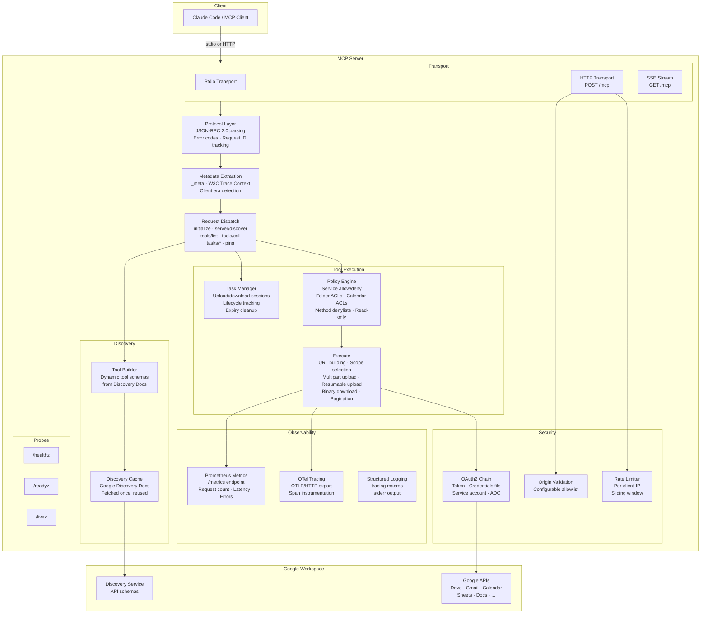
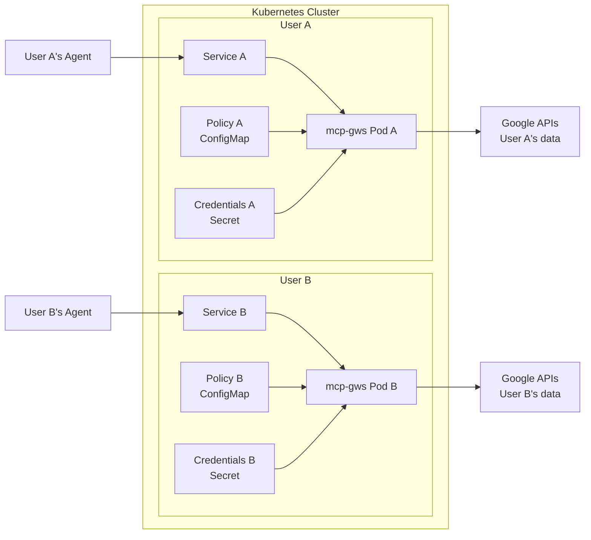

# Architecture

## Request Flow



## Module Map

```
src/
├── main.rs              CLI arg parsing, templates, interactive wizard, policy checker
├── lib.rs               Library crate root, module declarations
├── handler.rs           rmcp ServerHandler: tools, prompts, resources, completions, tasks, elicitation, subscriptions, lazy discovery
├── server.rs            Tool dispatch, shared utilities, image gen, batch, tasks
├── http.rs              Hybrid Axum server: rmcp StreamableHttpService + health/metrics/webhooks
├── execute.rs           HTTP execution: URL rendering, params, pagination, resumable uploads, rate limiting
├── policy.rs            JSON policy engine: constraints, method denylists, read-only, recursive parent ancestry
├── tools.rs             Builds MCP tool list, lazy filtering by activated services, compact schema mode
├── meta.rs              Request metadata (W3C Trace Context)
├── auth.rs              OAuth2 chain: env var → credentials file → service account → ADC/gcloud
├── init.rs              Interactive setup wizard and policy templates
├── shared.rs            Shared utilities extracted to break circular dependency
├── drive_helpers.rs     Google Drive enrichment (9 tools)
├── gmail_helpers.rs     Gmail enrichment (10 tools)
├── sheets_helpers.rs    Google Sheets enrichment (14 tools)
├── helpers.rs           Google Docs enrichment (9 tools)
├── slides_helpers.rs    Google Slides enrichment (9 tools)
├── calendar_helpers.rs  Google Calendar enrichment (6 tools)
├── format.rs            Format transformers: Markdown/Plain → Docs batchUpdate, doc → Markdown
├── marp.rs              Marp Markdown to Google Slides conversion
├── image_gen.rs         Gemini image generation and Drive upload
├── cache.rs             LRU + TTL in-memory cache for Sheets values.get responses
├── rate_limit.rs        Per-service sliding-window rate limiter for Google API quotas
├── resources.rs         MCP resources: gws:// URI scheme, resource templates from Discovery Documents
├── completions.rs       MCP completions: autocomplete for resource URIs and prompt arguments
├── elicitation.rs       MCP elicitation: structured user input
├── subscriptions.rs     MCP subscriptions: Google Drive watch channels, webhook notifications
├── prompts.rs           MCP prompts: load external Markdown files, argument substitution
├── tasks.rs             Task lifecycle for resumable uploads and chunked downloads
├── metrics.rs           Prometheus counters, histograms, gauges
└── audit.rs             Structured JSONL audit log writer
```

## Multi-User Deployment

Each user gets their own server instance with their own credentials and policy:



This gives per-user isolation: different policies, credentials, rate limits, and no shared state.
