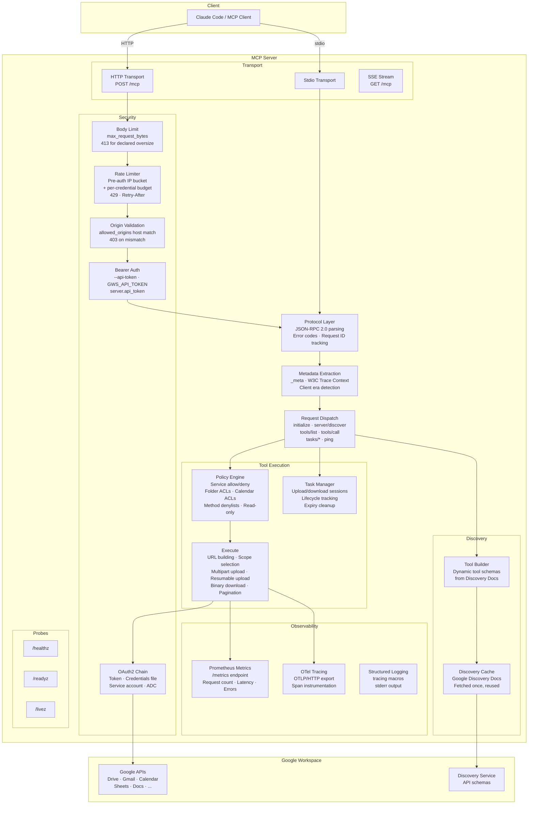
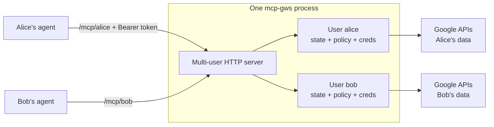
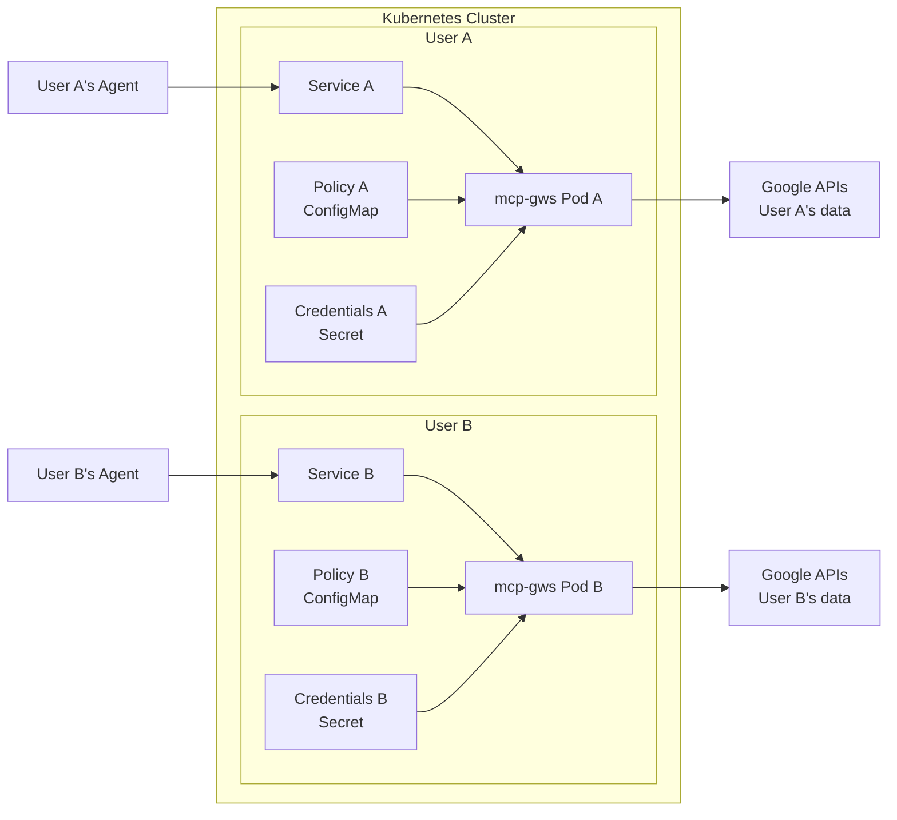

# Architecture

## Request Flow



## Module Map

```
src/
├── main.rs              CLI arg parsing, templates, interactive wizard, policy checker
├── lib.rs               Library crate root, module declarations
├── handler.rs           rmcp ServerHandler: tools, prompts, resources, completions, tasks, elicitation, subscriptions, lazy discovery
├── server.rs            Tool dispatch, shared utilities, image gen, batch, tasks
├── http.rs              Hybrid Axum server: rmcp StreamableHttpService + health/metrics/webhooks, multi-user routing, bearer auth, Origin/body-limit/per-IP middleware
├── users.rs             Multi-user mode: per-user policy/state loading from a users directory
├── execute.rs           HTTP execution: URL rendering, params, pagination, resumable uploads, rate limiting, Drive by-ID scoping (reads and writes)
├── policy.rs            JSON policy engine: constraints, method denylists/families, read-only, resource allowlists, recursive parent ancestry (reads and writes), delegation subjects, scoping warnings
├── tools.rs             Builds MCP tool list, lazy filtering by activated services, compact schema mode
├── meta.rs              Request metadata (W3C Trace Context)
├── auth.rs              OAuth2 chain: env var → credentials file → service account → ADC/gcloud
├── init.rs              Interactive setup wizard and policy templates
├── shared.rs            Shared utilities extracted to break circular dependency
├── drive_helpers.rs     Google Drive enrichment (9 tools)
├── gmail_helpers.rs     Gmail enrichment (10 tools)
├── sheets_helpers.rs    Google Sheets enrichment (14 tools)
├── helpers.rs           Google Docs enrichment (9 tools)
├── slides_helpers.rs    Google Slides enrichment (9 tools)
├── calendar_helpers.rs  Google Calendar enrichment (6 tools)
├── tasks_helpers.rs     Google Tasks enrichment (8 tools)
├── format.rs            Format transformers: Markdown/Plain → Docs batchUpdate, doc → Markdown
├── marp.rs              Marp Markdown to Google Slides conversion
├── image_gen.rs         Gemini image generation and Drive upload
├── cache.rs             LRU + TTL in-memory cache for Sheets values.get responses
├── rate_limit.rs        Per-service outbound sliding-window limiter and per-client-IP HTTP limiter
├── resources.rs         MCP resources: gws:// URI scheme, resource templates from Discovery Documents
├── completions.rs       MCP completions: autocomplete for resource URIs and prompt arguments
├── elicitation.rs       MCP elicitation: structured user input, write approval (confirm_writes)
├── subscriptions.rs     MCP subscriptions: Google Drive watch channels, webhook notifications, polling fallback for stdio mode
├── prompts.rs           MCP prompts: load external Markdown files, argument substitution
├── tasks.rs             Task lifecycle for resumable uploads and chunked downloads
├── metrics.rs           Prometheus counters, histograms, gauges
└── audit.rs             Structured JSONL audit log writer
```

## HTTP Request Security Layers

The HTTP transport applies these layers to `/mcp`, outermost first. `/metrics`
runs the bearer-token middleware; `/healthz`, `/readyz`, and `/livez` stay open so
kubelet can reach them.

| Order | Layer | Configuration | Failure |
|-------|-------|---------------|---------|
| 1 | Transport body cap | `server.max_request_bytes` (captured at boot for chunked bodies) | connection rejected / `500` from the transport |
| 2 | Pre-authentication rate limit | Fixed ~60/min per client address; bounds credential guessing before any token comparison | `429` + `Retry-After: 60` |
| 3 | Origin validation | `server.allowed_origins` (host match); empty = localhost | `403` |
| 4 | Bearer authentication | `--api-token` → `GWS_API_TOKEN` → `server.api_token`; requirement latched at boot | `401` + `WWW-Authenticate: Bearer` |
| 5 | Authenticated rate limit | `server.rate_limit_rpm` (default 600/min), keyed on the credential | `429` + `Retry-After` |
| 6 | Declared body limit | `server.max_request_bytes` re-read from the current policy | `413` |
| 7 | Host allowlist | rmcp loopback defaults + bind host + `allowed_origins` hosts + `GWS_ALLOWED_HOSTS` | `403` from rmcp |

The client address used by the two rate-limit buckets is the socket peer, unless
`server.trusted_proxies` contains the peer's CIDR; then the rightmost untrusted
`X-Forwarded-For` hop is used. With no trusted proxies the header is ignored.
Trusted proxies are resolved once at listener construction: changing them
requires a restart, not a SIGHUP reload (which does not rebuild the middleware).
`rate_limit_rpm: 0` is a startup error, not "unlimited".

Every HTTP mode startup runs an authentication check: a token permits the bind,
`--insecure-no-auth` explicitly permits it, a loopback bind without a token logs
a warning, and a non-loopback bind without a token exits with status 1. In
multi-user mode every user endpoint must have a token (or the shared override)
for the non-loopback bind to be allowed.

Tokens are re-read from the shared policy on every request, so a SIGHUP rotation
applies immediately and both the old and the new token are accepted during the
change. Revocation is different: the *requirement* to authenticate is latched
when the listener is constructed, so a reload that removes the only token does
not open the listener — every request, `/metrics` included, gets `401` and an
error is logged until a token is restored or the process restarts.
`--api-token` / `GWS_API_TOKEN` are also captured at boot and are unaffected by
reload. Comparisons are constant-time. `/metrics` accepts the override token or
any user's configured token.

## Delegation Trust Model

`_meta.user_email` is client-controlled and is therefore **not** trusted. The
server resolves a delegation subject as follows:

1. If the client supplies `_meta.user_email`, it is accepted only when it
   case-insensitively matches an entry in `server.allowed_subjects`. Otherwise
   the request fails and the rejection is audited.
2. If the client supplies no subject, `server.delegate_subject` is used when set.
3. If neither exists, requests run as the configured credentials with no
   impersonation.

An empty `allowed_subjects` (the default) disables per-request delegation, so a
compromised or confused client cannot ask the server to act as another user.
`delegate_subject` is operator-controlled configuration and is the safer choice
for a single fixed service identity.

## Multi-User Deployment

There are two ways to run multiple users:

**Single process (multi-user mode)** — run one HTTP server with a users
directory; each user gets an isolated state, policy, credentials, and
audit log, served at `/mcp/<user>` with optional bearer-token
authentication (`server.api_token`):



**One process per user** — each user gets their own server instance with
their own credentials and policy:



This gives per-user isolation: different policies, credentials, rate limits, and no shared state.
